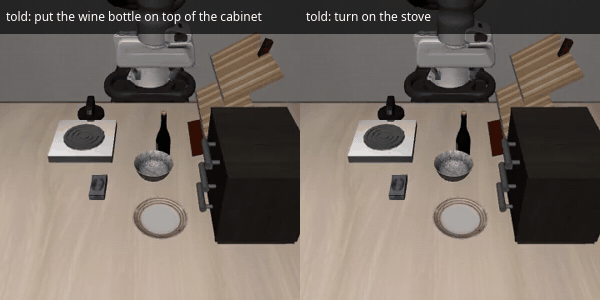
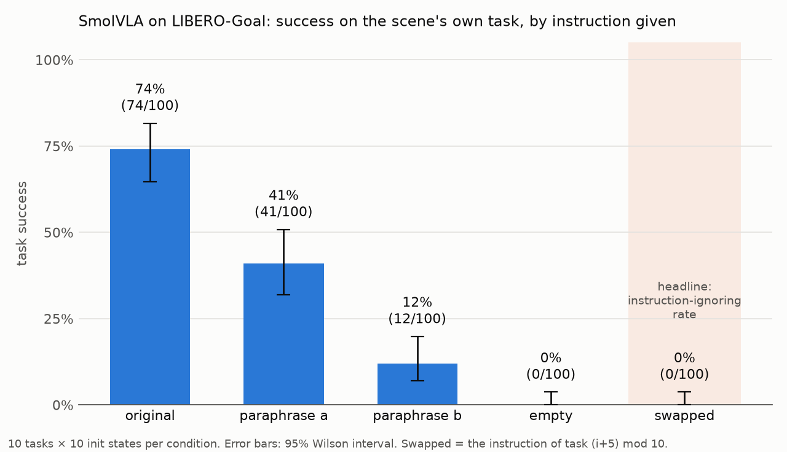
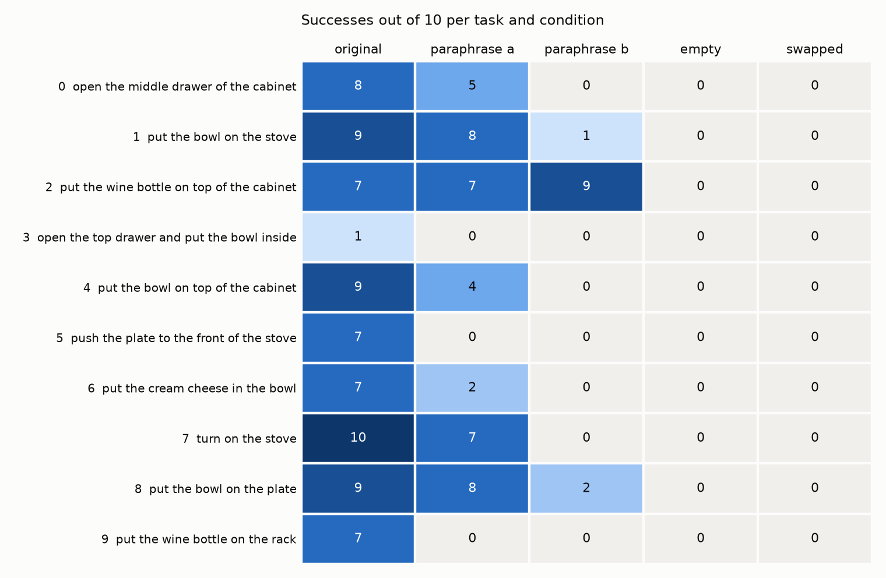
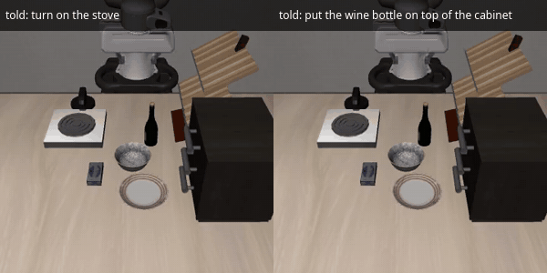
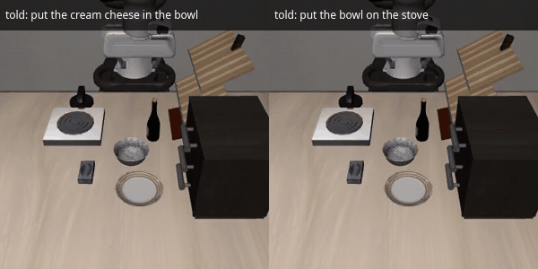

# smolvla-listens

**Does a 450M VLA actually read its instructions?** A language audit of [SmolVLA](https://huggingface.co/HuggingFaceVLA/smolvla_libero) on LIBERO-Goal.



*Same scene, same starting state. Left: the policy hears its real instruction. Right: it hears another task's instruction ("turn on the stove") and does that instead.*

## TL;DR

In a 500-episode simulation test (10 LIBERO-Goal tasks × 10 initial states × 5 instruction conditions):

1. **SmolVLA does not ignore its instruction.** Given another task's instruction, it completed the scene's original task in **0 / 100** episodes (95% CI 0–3.7%). Instead it went for the task it was told: all 10 labelled videos attempted the swapped-in task, and the simulator's own goal check says it **completed it in 76 / 100** episodes (95% CI 67–83%), about as often as those tasks succeed with their own instruction (74 / 100).
2. **It cannot work without one.** With an empty instruction, success is **0 / 100**. The robot drifts to the stove in every scene.
3. **But it is brittle to wording.** Success falls from **74%** (original wording) to **41%** (light rewording, e.g. *put → place*) and **12%** (restructured sentence). On the same initial states, rewording turned 36 successes into failures and only 3 failures into successes (McNemar p < 10⁻⁷).

In short: **SmolVLA follows its instruction, even when the scene "belongs" to another task, but mostly only when the sentence is phrased like its training data.**

## Why it matters

Recent LIBERO robustness studies suggest that VLA policies can score well while largely ignoring their instructions. LIBERO-Plus (Fei et al., [arXiv 2510.13626](https://arxiv.org/abs/2510.13626)) finds models "largely insensitive to language variations", and LIBERO-PRO (Zhou et al., [arXiv 2510.03827](https://arxiv.org/abs/2510.03827)) finds outputs that "remain unchanged even when given corrupted instructions". Neither study tested SmolVLA, so it was an open question whether a compact 450M policy actually listens.

## Setup

- **Model:** [`HuggingFaceVLA/smolvla_libero`](https://huggingface.co/HuggingFaceVLA/smolvla_libero), used as released (no fine-tuning).
- **Benchmark:** LIBERO-Goal, all 10 tasks. Every task uses the same kitchen and the same objects, so the instruction is the main thing that tells the robot which task to do.
- **Design:** every condition uses the same 10 tasks × the same 10 initial states (`--env.init_states=true`, `--seed=1000`), so the only thing that changes is the sentence. Success is always LIBERO's own check of the *scene's* task goal, at most 300 steps per episode.
- **Hardware:** one RTX 5060 Laptop GPU (8 GB), Ubuntu 24.04, LeRobot commit `297774fc`. Evaluation uses about 2.2 GB of GPU memory and 30–60 s per episode.

| Condition | What the policy hears in task *i*'s scene | File |
|---|---|---|
| `original` | task *i*'s real instruction | [`tasks.json`](instructions/tasks.json) |
| `paraphrase_a` | light rewording: same objects, synonym verbs and prepositions | [`paraphrase_a.json`](instructions/paraphrase_a.json) |
| `paraphrase_b` | heavier rewording: sentence structure changed | [`paraphrase_b.json`](instructions/paraphrase_b.json) |
| `empty` | `""` | [`empty.json`](instructions/empty.json) |
| `swapped` | task (*i*+5) mod 10's instruction | [`swapped.json`](instructions/swapped.json) |

The instruction is replaced by [`scripts/eval_with_instruction.py`](scripts/eval_with_instruction.py), a ~90-line wrapper around `lerobot-eval`. It patches `LiberoEnv.__init__` so the env's `task_description` (which LeRobot copies into `observation["task"]` every step) holds the chosen sentence, and prints an `[override]` line as proof. LeRobot itself is not modified.

**Can the robot tell the task from the image alone?** Probably not. Episode *k* of every task starts from almost the same scene. In a crude first-frame pixel check, two *different* tasks with the same init state differed in ~3.8% of pixels, while two episodes of the *same* task differed in ~7.3%.

## Results



| Condition | Success | 95% CI (Wilson) |
|---|---|---|
| original | 74 / 100 | 64.6–81.6% |
| paraphrase_a | 41 / 100 | 31.9–50.8% |
| paraphrase_b | 12 / 100 | 7.0–19.8% |
| empty | 0 / 100 | 0.0–3.7% |
| swapped | 0 / 100 | 0.0–3.7% |

**Paired comparison with `original`** (same task, same initial state; [`paired_vs_original.csv`](results/paired_vs_original.csv)):

| Condition | Both succeed | Only original succeeds | Only this condition succeeds | McNemar exact p |
|---|---|---|---|---|
| paraphrase_a | 38 | 36 | 3 | 3.6 × 10⁻⁸ |
| paraphrase_b | 9 | 65 | 3 | 3.6 × 10⁻¹⁶ |



Per task ([`per_task.csv`](results/per_task.csv)):
- Task 3 ("open the top drawer and put the bowl inside") is hard even with the right sentence (1/10), so its zeros elsewhere say nothing about language.
- A light rewording sent task 5 (*push → slide*) and task 9 (*put → place, on → onto*) from 7/10 to 0/10, while tasks 1 and 8 kept 8/10 with the same *place … onto* change.
- The one heavy rewording that kept working (task 2, 9/10) is the only one that still starts with a verb: "**get** the wine bottle up on top of the cabinet". That is one task, so treat it as a hypothesis.

### What did the robot do when told another task?

**Labelled videos** (episode 0 of every swapped task, by eye; [`swap_labels.csv`](results/swap_labels.csv)):

| Did the original task | Attempted the swapped-in task | Neither (froze or wandered) |
|---|---|---|
| 0 / 10 | **10 / 10** (about 7 visibly completed) | 0 / 10 |

**Simulator goal check** (a re-run of all 100 swapped episodes that also evaluates the *swapped-in* task's BDDL goal at every step; [`swapped_goal.csv`](results/swapped_goal.csv)):

| Scene (task) | Told (task's instruction) | Told task completed | Same task, own scene & instruction |
|---|---|---|---|
| 0 | 5: push the plate to the front of the stove | 8 / 10 | 7 / 10 |
| 1 | 6: put the cream cheese in the bowl | 7 / 10 | 7 / 10 |
| 2 | 7: turn on the stove | 10 / 10 | 10 / 10 |
| 3 | 8: put the bowl on the plate | 10 / 10 | 9 / 10 |
| 4 | 9: put the wine bottle on the rack | 6 / 10 | 7 / 10 |
| 5 | 0: open the middle drawer of the cabinet | 8 / 10 | 8 / 10 |
| 6 | 1: put the bowl on the stove | 7 / 10 | 9 / 10 |
| 7 | 2: put the wine bottle on top of the cabinet | 10 / 10 | 7 / 10 |
| 8 | 3: open the top drawer and put the bowl inside | 0 / 10 | 1 / 10 |
| 9 | 4: put the bowl on top of the cabinet | 10 / 10 | 9 / 10 |
| **all** | | **76 / 100** (95% CI 67–83%) | **74 / 100** |

Told another task, SmolVLA completes it about as often as it completes that task normally (76% vs 74%), and in the same re-run it again completed the scene's own task in 0 / 100 episodes. The only weak cell is the instruction that is hard everywhere (task 3, 1/10 even in its own scene).

<table><tr>
<td></td>
<td></td>
</tr></table>

**With an empty instruction** the policy does the same thing in every scene: it moves to the stove and hovers around it for the whole episode without grasping anything.

## What this does and doesn't show

- **Sim only, one model, one suite.** These results are for `smolvla_libero` on LIBERO-Goal in MuJoCo. They say nothing directly about real robots, other checkpoints or other suites.
- **Ten episodes per cell.** Per-task numbers have wide intervals (7/10 is anywhere from about 40% to 89%). The condition-level and paired results are much tighter.
- **Hand-written paraphrases.** One author wrote one set of rewordings in one pass. Another set could give different numbers, so read 41% / 12% as "rewording hurts a lot", not as exact constants.
- **Labels are by eye** on one episode per task. The simulator goal check is the quantitative version.
- **Re-runs are not frame-identical.** With the same seed, a re-run over a different set of tasks can play out differently, because the policy samples noise. Initial states always match.
- **LIBERO-Goal makes language necessary by design** (identical scenes). In suites where the scene gives the task away, a policy could score well while ignoring language, which is the failure LIBERO-Plus and LIBERO-PRO report.

## Reproduce

Environment (as used here; see LeRobot's docs for other setups):

```bash
conda create -y -n lerobot --override-channels -c conda-forge \
    python=3.12 ffmpeg git git-lfs cmake make compilers pkg-config
conda activate lerobot
pip install --index-url https://download.pytorch.org/whl/cu128 torch torchvision   # RTX 50xx needs cu128
git clone https://github.com/huggingface/lerobot.git && cd lerobot && git checkout 297774fc
CMAKE_POLICY_VERSION_MINIMUM=3.5 pip install -e ".[smolvla,libero,training]"
conda env config vars set -n lerobot MUJOCO_GL=egl PYOPENGL_PLATFORM=egl && conda activate lerobot
```

Then, from this repo:

```bash
# 1 task, 1 episode, swapped instruction: prints "[override] task 0: ... -> ..."
INSTR_MAP=instructions/swapped.json python scripts/eval_with_instruction.py \
  --policy.path=HuggingFaceVLA/smolvla_libero --env.type=libero --env.task=libero_goal \
  --env.task_ids='[0]' --eval.batch_size=1 --eval.n_episodes=1 --output_dir=outputs/try

# full audit: 5 conditions × 10 tasks × 10 episodes (~7 h on an 8 GB laptop GPU; skips finished conditions)
bash scripts/run_all.sh 10

# swapped re-run with a goal check of the swapped-in task (~1.5 h)
GOAL_MAP=instructions/swapped_goal_map.json INSTR_MAP=instructions/swapped.json \
  python scripts/eval_with_instruction.py --policy.path=HuggingFaceVLA/smolvla_libero \
  --env.type=libero --env.task=libero_goal --eval.batch_size=1 --eval.n_episodes=10 \
  --seed=1000 --output_dir=outputs/E3_swapped_goalcheck > outputs/E3_swapped_goalcheck.log 2>&1

python scripts/analyze.py         # -> results/*.csv and *.png
bash scripts/make_gif.sh left.mp4 right.mp4 assets/out.gif "left caption" "right caption"
```

For overnight runs on GNOME, wrap the command in `systemd-inhibit --what=sleep:idle:handle-lid-switch gnome-session-inhibit --inhibit suspend:idle …`. GNOME's idle suspend ignores `systemd-inhibit` alone.

## Repo layout

```
instructions/   the five conditions, plus swapped_goal_map.json for the goal check
scripts/        eval_with_instruction.py, run_all.sh, analyze.py, make_gif.sh, time_train.sh
results/        summary.csv, per_task.csv, paired_vs_original.csv, swap_labels.csv, swapped_goal.csv, plots
assets/         side-by-side GIFs (original vs swapped)
```

Raw videos and logs (`outputs/`) are not committed.

## Next steps

- **More paraphrases:** many rewordings per task, to separate "keys on the sentence template" (the verb-first hint above) from "keys on particular words".
- **Visual perturbations:** lighting, camera noise, a blacked-out wrist camera. Does the policy lean on vision or language when they conflict?
- **A fine-tuning fix:** train with paraphrased instructions (or a counterfactual-instruction objective) and check whether paraphrase robustness improves without losing original-task success.
- **Other small VLAs and suites**, to see whether brittle-but-obedient is specific to SmolVLA.

## Acknowledgements

[LeRobot](https://github.com/huggingface/lerobot) (evaluation stack), [SmolVLA](https://huggingface.co/papers/2506.01844) and the `smolvla_libero` checkpoint by Hugging Face, and [LIBERO](https://libero-project.github.io/) (benchmark and simulator). Robustness framing from LIBERO-Plus and LIBERO-PRO.

## License

[MIT](LICENSE)
